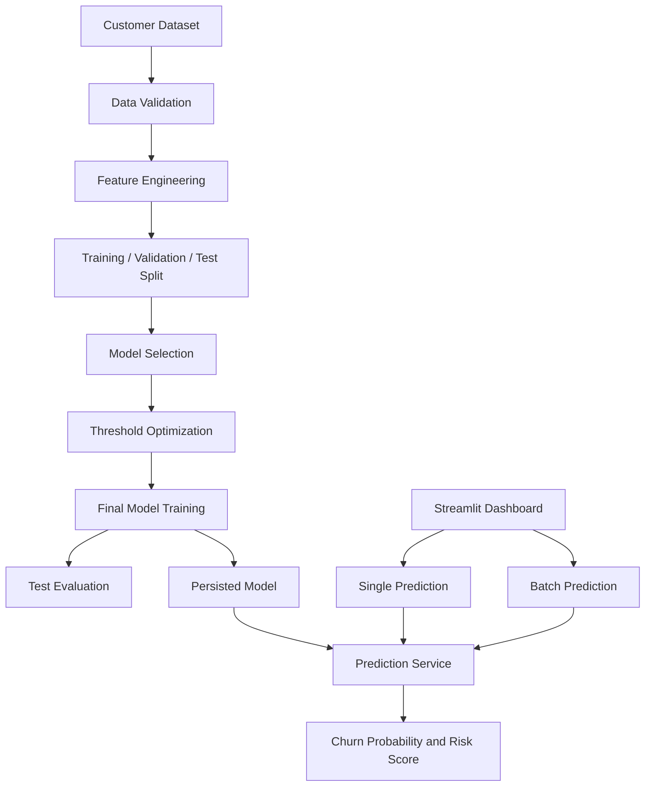
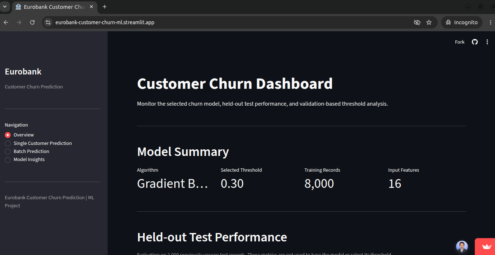
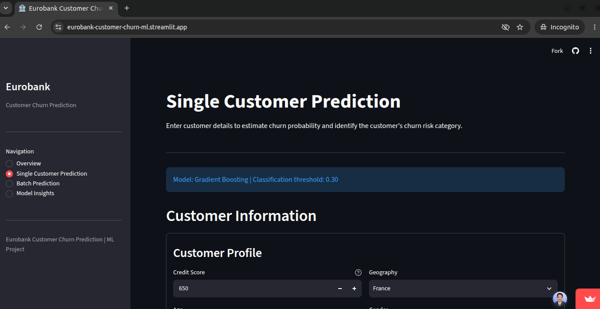
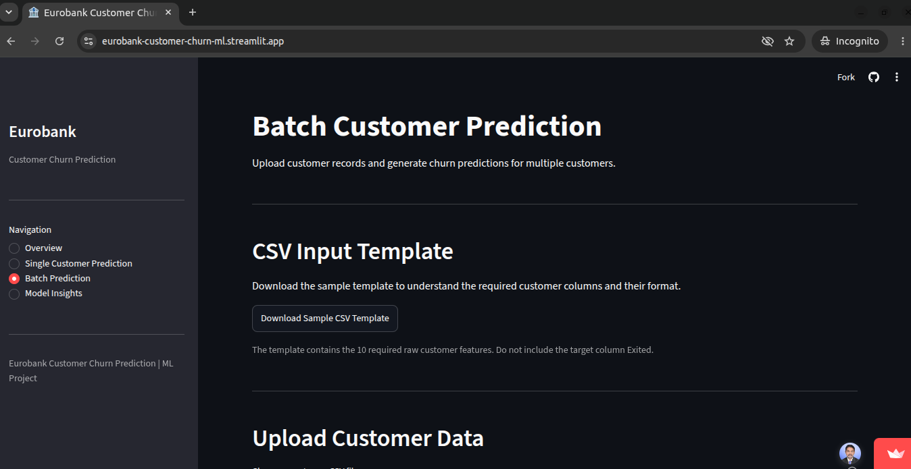
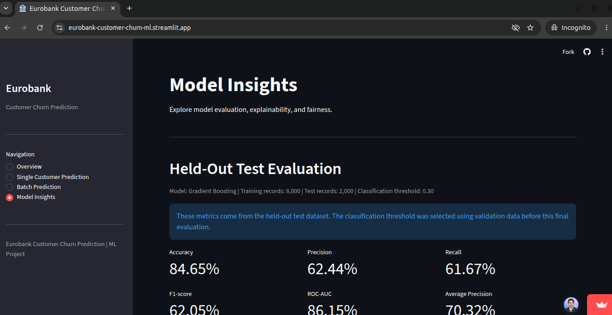

# Predictive Modeling and Risk Scoring for Bank Customer Churn

An end-to-end machine learning project that predicts bank customer churn, estimates customer risk, and supports data-driven retention decisions.

**Repository:** `eurobank-customer-churn-prediction`

**GitHub:** [PranayIngole7/eurobank-customer-churn-prediction](https://github.com/PranayIngole7/eurobank-customer-churn-prediction)

**Live Demo:** [Open Streamlit Dashboard](https://eurobank-customer-churn-ml.streamlit.app/)

---

## 1. Project Overview

This project develops a binary classification model to estimate the likelihood of a bank customer leaving the organization.

It covers the complete machine learning workflow, including data validation, exploratory analysis, feature engineering, model selection, evaluation, explainability, fairness analysis, and application integration.

- **Selected model:** Gradient Boosting
- **Decision threshold:** 0.30 (selected using validation data)
- **Application:** Interactive Streamlit dashboard

The target variable is `Exited` (`1` = churned, `0` = retained).

---

## 2. Key Features

- Data quality validation and exploratory data analysis.
- Feature engineering and preprocessing pipelines.
- Comparison of multiple classification algorithms.
- Class imbalance analysis and validation-based threshold selection.
- Customer churn probability and risk scoring.
- Model explainability using SHAP, permutation importance, and partial dependence.
- Fairness analysis across demographic groups.
- Reusable single-customer and batch prediction services.
- Four-page Streamlit dashboard:
  - Overview
  - Single Customer Prediction
  - Batch Prediction
  - Model Insights
- Automated tests using Pytest.

---

## 3. Model & Evaluation

Gradient Boosting was selected using validation F1-score among candidate model and threshold combinations satisfying a validation precision floor of 0.50.

The dataset was divided using a stratified 80/20 split:

| Partition     | Records | Purpose                              |
| ------------- | ------: | ------------------------------------ |
| Training      |   8,000 | Model development and final training |
| Held-out test |   2,000 | Independent final evaluation         |

The training partition was further divided for internal training and validation. Model selection and threshold optimization were performed without using held-out test data.

**Final held-out test results:**

| Metric            |  Score |
| ----------------- | -----: |
| Accuracy          | 0.8465 |
| Precision         | 0.6244 |
| Recall            | 0.6167 |
| F1-score          | 0.6205 |
| ROC-AUC           | 0.8615 |
| Average Precision | 0.7032 |

Detailed methodology and results: [`reports/final-model-evaluation.md`](reports/final-model-evaluation.md).

Additional analysis:
- [`reports/model-explainability.md`](reports/model-explainability.md)
- [`reports/fairness-analysis.md`](reports/fairness-analysis.md)
- [`reports/business-impact-analysis.md`](reports/business-impact-analysis.md)

---

## 4. System Architecture

The project separates model development from application inference.

**Model development:** Data validation → Feature engineering → Data splitting → Model selection → Threshold optimization → Final training and evaluation → Model persistence.

**Prediction workflow:** Streamlit dashboard → Prediction service → Feature validation and engineering → Persisted model → Churn probability and risk prediction.



**Technology stack**

| Category          | Technologies        |
| ----------------- | ------------------- |
| Language          | Python 3.10+        |
| Data Processing   | Pandas, NumPy       |
| Visualization     | Matplotlib, Seaborn |
| Machine Learning  | Scikit-learn        |
| Explainability    | SHAP                |
| Model Persistence | Joblib              |
| Dashboard         | Streamlit           |
| Testing           | Pytest              |
| Version Control   | Git, GitHub         |

---

## 5. Application Screenshots

The deployed Streamlit dashboard provides four sections for customer churn prediction and model evaluation.

| Dashboard Overview                              | Single Customer Prediction                                       |
| ----------------------------------------------- | ---------------------------------------------------------------- |
|  |  |

| Batch Prediction                                      | Model Insights                                    |
| ----------------------------------------------------- | ------------------------------------------------- |
|  |  |

**Live Demo:** [Open Streamlit Dashboard](https://eurobank-customer-churn-ml.streamlit.app/)

---

## 6. Installation & Usage

**Prerequisites:** Python 3.10+, Git, and pip.

**Clone the repository**

```bash
git clone https://github.com/PranayIngole7/eurobank-customer-churn-prediction.git

cd eurobank-customer-churn-prediction
```

**Create and activate a virtual environment**

```bash
python3 -m venv .venv
source .venv/bin/activate
```

**Install dependencies**

```bash
python -m pip install --upgrade pip
pip install -r requirements-dev.txt
```

**Launch the dashboard**

```bash
streamlit run app.py
```

The repository includes the persisted model artifacts required by the dashboard. The original dataset is not included.

**Run automated tests**

```bash
python -m pytest -q
```

To reproduce model training, obtain the authorized dataset and place it at:

```text
data/raw/european-bank.csv
```

Then run:

```bash
python -m scripts.train_final_model
```

This command regenerates model and evaluation artifacts.

---

## 7. Dataset & Conclusion

### Dataset

The project uses a bank customer dataset containing 10,000 records and 14 original columns.

The target variable is `Exited`, indicating whether a customer left the bank. Customer identifiers and personal names are excluded from model training.

### Conclusion

This project demonstrates an end-to-end machine learning workflow for bank customer churn prediction, from data preparation and model development to evaluation, explainability, fairness analysis, and application deployment.

The selected Gradient Boosting model achieves an F1-score of **0.6205** and ROC-AUC of **0.8615** on the independent held-out test dataset.

The Streamlit dashboard provides interactive single-customer and batch predictions, along with model evaluation and insights.

The project provides a practical foundation for exploring data-driven customer retention strategies. Predictions should be validated against real-world business requirements before operational use.

**Detailed documentation:** Refer to the technical reports in the [`reports/`](reports/) directory.

---