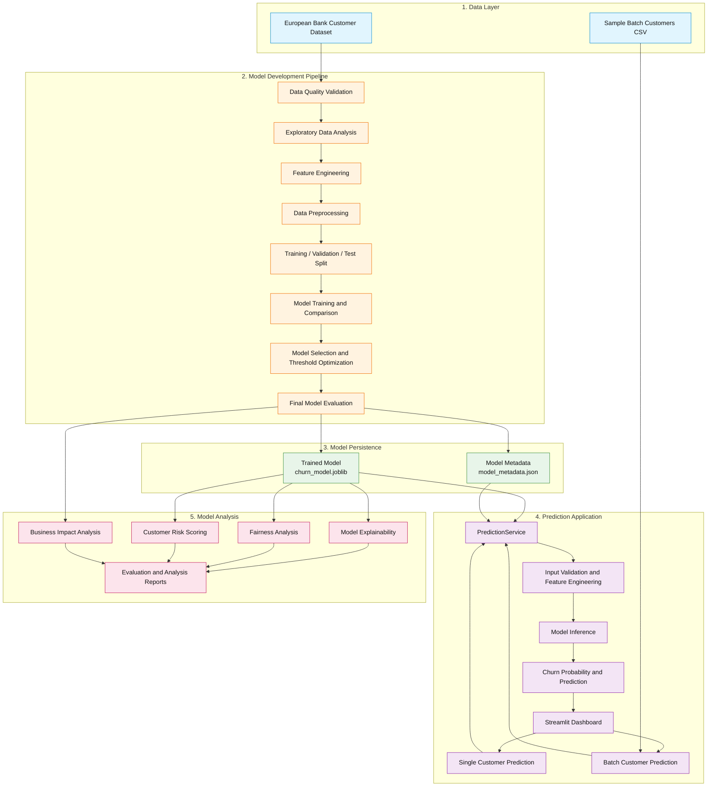

# Predictive Modeling and Risk Scoring for Bank Customer Churn

**Repository:** `eurobank-customer-churn-prediction`

An end-to-end machine learning project for predicting bank customer churn, evaluating customer risk, and supporting data-driven customer retention decisions.

---

## 1. Project Overview

Predictive Modeling and Risk Scoring for Bank Customer Churn is a machine learning project that estimates the likelihood of a bank customer leaving the organization.

The project covers the complete machine learning workflow, from data validation and exploratory analysis to model development, evaluation, explainability, fairness analysis, model persistence, and application integration.

It includes a reusable prediction service and an interactive Streamlit dashboard for individual and batch customer predictions.

**Selected model:** Balanced Logistic Regression
**Classification threshold:** 0.65

---

## 2. Problem Statement

Customer churn is a significant challenge for financial institutions. Losing existing customers can affect revenue, customer relationships, and long-term business growth.

Identifying customers who are more likely to leave allows organizations to investigate potential risks and prioritize retention efforts.

The objective of this project is to build a binary classification model that predicts customer churn using historical customer information.

The target variable is `Exited`:

- `1` — Customer exited.
- `0` — Customer retained.

---

## 3. Project Objectives

- Understand customer data through exploratory data analysis.
- Validate data quality and prepare features for machine learning.
- Investigate customer characteristics associated with churn.
- Develop and compare multiple classification algorithms.
- Address class imbalance during model development.
- Optimize the classification threshold using validation data.
- Evaluate model performance on an independent test dataset.
- Explain model predictions and assess fairness across demographic groups.
- Persist the selected model for reusable inference.
- Develop an interactive dashboard for customer-level and batch predictions.

---

## 4. Key Features

- Data quality checks and exploratory data analysis.
- Feature engineering and preprocessing pipelines.
- Comparison of multiple classification algorithms.
- Class imbalance handling.
- Validation-based threshold optimization.
- Customer churn probability and risk scoring.
- Model explainability using coefficients and permutation importance.
- Local customer prediction explanations.
- Fairness analysis across demographic groups.
- Model persistence with metadata validation.
- Single-customer and batch prediction service.
- Four-section Streamlit dashboard.
- Automated unit, integration, and application tests.

---

## 5. Tech Stack

| Category              | Technologies        |
| --------------------- | ------------------- |
| Programming Language  | Python 3.10+        |
| Data Processing       | Pandas, NumPy       |
| Data Visualization    | Matplotlib, Seaborn |
| Machine Learning      | Scikit-learn        |
| Model Persistence     | Joblib              |
| Interactive Dashboard | Streamlit           |
| Testing               | Pytest              |
| Notebooks             | JupyterLab          |
| Version Control       | Git, GitHub         |

---

## 6. Architecture and Project Structure

### 6.1 System Architecture

The project follows a modular machine learning application architecture. It separates data preparation, model development, model persistence, prediction services, and dashboard presentation.

The architecture has two primary workflows:

- **Model Development Pipeline:** Processes historical customer data, develops and evaluates classification models, and persists the selected model.
- **Prediction Pipeline:** Loads the persisted model and provides single-customer or batch predictions through a reusable prediction service and Streamlit dashboard.

### Architecture Diagram



### Architecture Components

| Component           | Responsibility                                                                 |
| ------------------- | ------------------------------------------------------------------------------ |
| Data Layer          | Provides historical customer data and sample batch prediction inputs.          |
| Data Quality        | Validates the input dataset before model development.                          |
| Feature Engineering | Creates additional features such as `HasBalance` and `AgeGroup`.               |
| Preprocessing       | Prepares numerical and categorical features for model training and inference.  |
| Model Development   | Trains and compares classification algorithms.                                 |
| Model Evaluation    | Evaluates the selected model using validation and held-out test data.          |
| Model Persistence   | Saves the trained model and metadata for reuse.                                |
| Prediction Service  | Provides reusable single-customer and batch inference functionality.           |
| Streamlit Dashboard | Provides the user interface for predictions and model insights.                |
| Model Analysis      | Supports explainability, fairness, risk scoring, and business impact analysis. |

### 6.2 Project Structure

```text
eurobank-customer-churn-prediction/
│
├── app.py
│
├── dashboard/
│   ├── __init__.py
│   ├── overview.py
│   ├── single_prediction.py
│   ├── batch_prediction.py
│   ├── model_insights.py
│   ├── components.py
│   ├── data_access.py
│   └── services.py
│
├── data/
│   ├── raw/
│   │   └── european-bank.csv
│   ├── sample_batch_customers.csv
│   └── batch_prediction_results.csv
│
├── models/
│   ├── churn_model.joblib
│   └── model_metadata.json
│
├── notebooks/
│   ├── 01_exploratory_data_analysis.ipynb
│   └── 02_feature_engineering.ipynb
│
├── reports/
│   ├── baseline-model.md
│   ├── business-impact-analysis.md
│   ├── customer-risk-scoring.md
│   ├── evaluation-report.md
│   ├── fairness-analysis.md
│   ├── final-model-evaluation.md
│   ├── model-deployment.md
│   ├── model-explainability.md
│   ├── model-improvement.md
│   └── preprocessing.md
│
├── scripts/
│   ├── analyze_business_impact.py
│   ├── analyze_model_explainability.py
│   ├── analyze_model_fairness.py
│   ├── compare_thresholds.py
│   ├── evaluate_validation.py
│   ├── explain_customer_predictions.py
│   ├── generate_risk_scores.py
│   └── train_final_model.py
│
├── src/
│   ├── data_quality.py
│   ├── data_split.py
│   ├── evaluation.py
│   ├── explainability.py
│   ├── fairness.py
│   ├── feature_engineering.py
│   ├── final_model_training.py
│   ├── modeling.py
│   ├── model_persistence.py
│   ├── prediction_service.py
│   ├── preprocessing.py
│   └── risk_scoring.py
│
├── tests/
│   ├── test_batch_prediction.py
│   ├── test_data_access.py
│   ├── test_data_quality.py
│   ├── test_data_split.py
│   ├── test_evaluation.py
│   ├── test_explainability.py
│   ├── test_fairness.py
│   ├── test_feature_engineering.py
│   ├── test_final_model_training.py
│   ├── test_modeling.py
│   ├── test_model_insights.py
│   ├── test_model_persistence.py
│   ├── test_prediction_service.py
│   ├── test_preprocessing.py
│   ├── test_risk_scoring.py
│   └── test_validation_split.py
│
├── .streamlit/
│   └── config.toml
│
├── requirements.txt
├── requirements-dev.txt
├── pytest.ini
├── .gitignore
└── README.md
```

---

## 7. Dataset Description

The project uses a European bank customer churn dataset containing **10,000 records and 13 original columns**, including the target variable `Exited`.

| Attribute          | Description           |
| ------------------ | --------------------- |
| Total records      | 10,000                |
| Original columns   | 13                    |
| Target variable    | `Exited`              |
| Problem type       | Binary classification |
| Churned customers  | 2,037 (20.37%)        |
| Retained customers | 7,963 (79.63%)        |

### Target Distribution

- Churned customers: 20.37%
- Retained customers: 79.63%

The target distribution demonstrates class imbalance, which is considered during model development and evaluation.

### Data Preparation

- Data quality and consistency checks.
- Removal of identifier and administrative columns from model inputs.
- Handling of numerical and categorical features.
- Categorical encoding and numerical preprocessing.
- Feature engineering.

Two engineered features include:

- `HasBalance` — Indicates whether a customer has a non-zero balance.
- `AgeGroup` — Groups customers into age categories.

The original dataset is not included in the repository. Place the authorized dataset CSV at:

```text
data/raw/european-bank.csv
```

---

## 8. Methodology

The project follows a structured machine learning workflow.

1. **Data Understanding:** Inspect the dataset, feature distributions, and target distribution.
2. **Data Quality:** Validate input data and identify data quality issues.
3. **Exploratory Data Analysis:** Investigate customer characteristics and churn patterns.
4. **Feature Engineering:** Create meaningful features and prepare model inputs.
5. **Preprocessing:** Encode categorical variables and prepare numerical features.
6. **Data Splitting:** Separate training, validation, and held-out test data.
7. **Baseline Modeling:** Establish reference performance.
8. **Model Development:** Train and compare classification algorithms.
9. **Model Improvement:** Address class imbalance and evaluate threshold choices.
10. **Model Evaluation:** Assess the selected model on held-out test data.
11. **Explainability and Fairness:** Examine model behavior, feature contributions, and group-level performance.
12. **Model Persistence:** Save the trained model and associated metadata.
13. **Application Integration:** Provide reusable predictions through a service and Streamlit dashboard.

The final classification threshold was selected using validation data. The held-out test partition was reserved for final model evaluation.

---

## 9. Machine Learning Algorithms

The project evaluates the following classification algorithms:

| Algorithm           | Purpose                                  |
| ------------------- | ---------------------------------------- |
| Logistic Regression | Linear classification baseline           |
| Decision Tree       | Rule-based classification                |
| Random Forest       | Ensemble of decision trees               |
| Gradient Boosting   | Sequential boosting-based classification |

### Selected Model

**Balanced Logistic Regression** was selected based on validation experiments.

Class balancing was used to account for the unequal distribution of churn and retained customers.

The classification threshold was optimized using validation data rather than assuming the default threshold of 0.50.

**Selected threshold: 0.65**

---

## 10. Model Evaluation

The final model was trained using 8,000 records and evaluated on 2,000 held-out test records.

The following metrics were used to evaluate performance:

- Accuracy
- Precision
- Recall
- F1-score
- ROC-AUC
- Average Precision

These metrics provide different perspectives on classification performance, particularly when the target classes are imbalanced.

---

## 11. Results and Visualizations

### Final Test Results

| Metric            | Result |
| ----------------- | -----: |
| Accuracy          | 0.8000 |
| Precision         | 0.5081 |
| Recall            | 0.5405 |
| F1-score          | 0.5238 |
| ROC-AUC           | 0.7948 |
| Average Precision | 0.5460 |

### Interpretation

- The model correctly classifies 80% of the held-out test observations.
- Precision and recall provide insight into the model's churn predictions.
- The F1-score summarizes the balance between precision and recall.
- ROC-AUC measures the model's ability to distinguish between the two classes across thresholds.
- Average Precision provides an additional perspective on performance for the imbalanced classification problem.

### Analysis and Visualizations

The project includes evaluation and analysis outputs covering:

- Classification reports and confusion matrices.
- ROC and precision-recall curves.
- Threshold comparison.
- Feature coefficients and permutation importance.
- Local customer prediction contributions.
- Fairness group metrics.
- Customer risk scores.

Detailed evaluation results are available in:

- `reports/final-model-evaluation.md`
- `reports/evaluation-report.md`
- `reports/model-explainability.md`
- `reports/fairness-analysis.md`

---

## 12. Installation and Setup

### Prerequisites

- Python 3.10 or later
- Git
- pip

### Clone the Repository

```bash
git clone https://github.com/PranayIngole7/eurobank-customer-churn-prediction.git

cd eurobank-customer-churn-prediction
```

### Create a Virtual Environment

```bash
python3 -m venv .venv

source .venv/bin/activate
```

### Install Dependencies

For development, testing, and notebook work:

```bash
python -m pip install --upgrade pip

pip install -r requirements-dev.txt
```

For dashboard and prediction-service runtime only:

```bash
pip install -r requirements.txt
```

### Prepare the Dataset

Place the authorized dataset file at:

```text
data/raw/european-bank.csv
```

---

## 13. How to Run the Project

### Step 1: Train the Final Model

```bash
python -m scripts.train_final_model
```

This command generates:

- Persisted model: `models/churn_model.joblib`
- Model metadata: `models/model_metadata.json`
- Machine-readable evaluation: `reports/final-model-test-evaluation.json`
- Final evaluation report: `reports/final-model-evaluation.md`

### Step 2: Launch the Dashboard

```bash
streamlit run app.py
```

The dashboard provides four sections:

| Section                    | Functionality                                               |
| -------------------------- | ----------------------------------------------------------- |
| Overview                   | Project and dataset insights                                |
| Single Customer Prediction | Predict churn for an individual customer                    |
| Batch Prediction           | Generate predictions for multiple customers using CSV input |
| Model Insights             | Explore model performance and explainability information    |

### Step 3: Run Automated Tests

```bash
python -m pytest -v
```

### Step 4: Launch JupyterLab

```bash
jupyter lab
```

The notebooks provide exploratory analysis and feature engineering workflows.

---

## 14. Conclusion

This project demonstrates an end-to-end machine learning workflow for bank customer churn prediction.

It combines data preparation, feature engineering, classification, threshold optimization, model evaluation, explainability, fairness analysis, and model persistence in a structured application.

The selected Balanced Logistic Regression model achieves an F1-score of 0.5238 and ROC-AUC of 0.7948 on the held-out test dataset.

The reusable prediction service and Streamlit dashboard demonstrate how a trained machine learning model can be integrated into an interactive application.

The project is intended as a machine learning portfolio and learning project. Its predictions should be validated against real business requirements before being used in operational customer-retention decisions.

---

## 15. References

- **Dataset:** European Bank Customer Churn dataset supplied separately for this project.
- **Scikit-learn Documentation:** https://scikit-learn.org/stable/user_guide.html
- **Pandas Documentation:** https://pandas.pydata.org/docs/
- **NumPy Documentation:** https://numpy.org/doc/
- **Streamlit Documentation:** https://docs.streamlit.io/
- **Joblib Documentation:** https://joblib.readthedocs.io/
- **Project Analysis:** See the Markdown reports in the `reports/` directory.

---

## 16. Project Information

| Field              | Details                                                             |
| ------------------ | ------------------------------------------------------------------- |
| Project Name       | Predictive Modeling and Risk Scoring for Bank Customer Churn        |
| Repository         | `eurobank-customer-churn-prediction`                                |
| GitHub             | https://github.com/PranayIngole7/eurobank-customer-churn-prediction |
| Domain             | Banking / Financial Services                                        |
| Project Type       | Machine Learning / Binary Classification                            |
| Primary Language   | Python                                                              |
| Selected Algorithm | Balanced Logistic Regression                                        |
| Application        | Streamlit Dashboard                                                 |
| Testing Framework  | Pytest                                                              |

---
