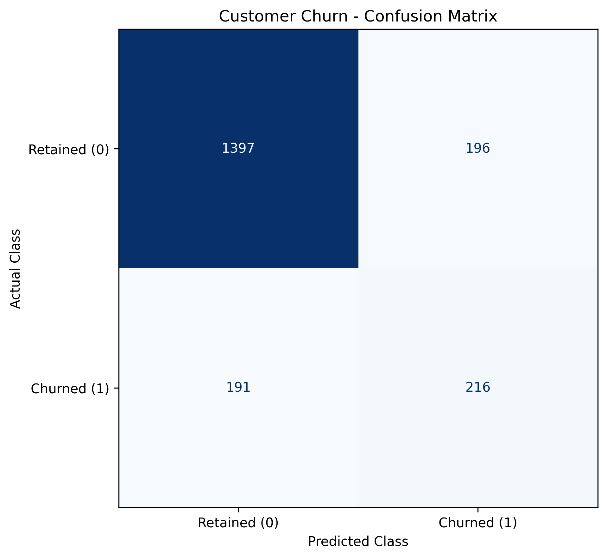
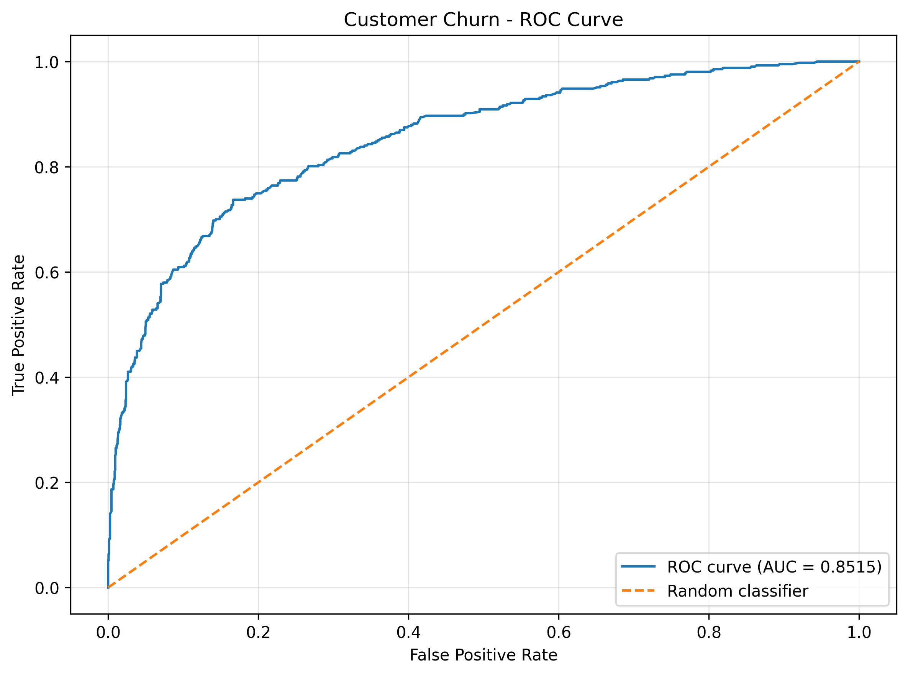
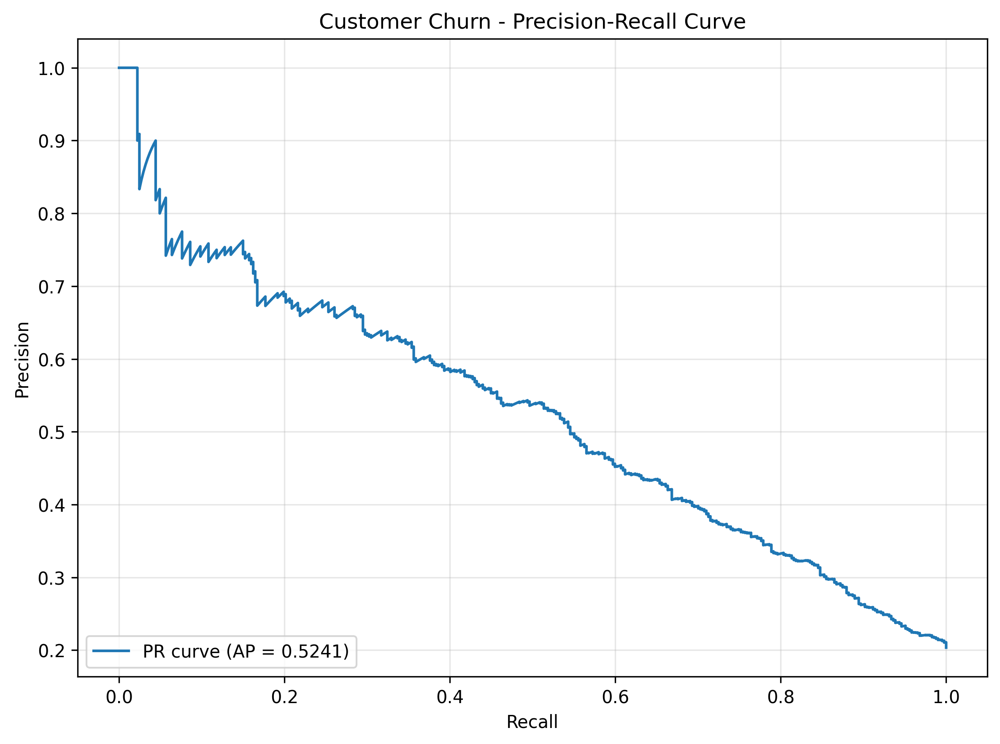
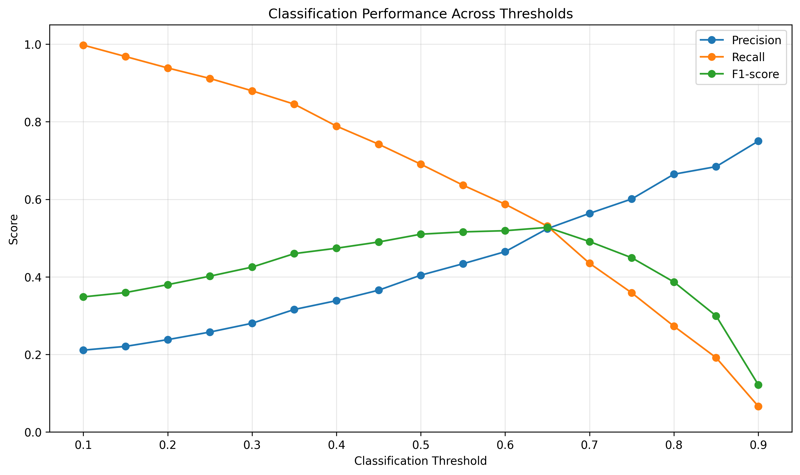

# Customer Churn Model Evaluation Report

## Objective

Evaluate the selected customer churn classification model using classification metrics, visualizations, threshold analysis, and business-oriented interpretation.

The selected model is Balanced Logistic Regression. The positive class (`Exited = 1`) represents customers who churned.

## Evaluation Methodology

The evaluation follows a leakage-safe workflow:

| Dataset           | Records | Purpose                              |
| ----------------- | ------: | ------------------------------------ |
| Internal training |   6,000 | Model fitting during experimentation |
| Validation        |   2,000 | Model and threshold selection        |
| Original training |   8,000 | Final model refitting                |
| Original test     |   2,000 | Final unseen-data evaluation         |

Model selection and threshold optimization used validation data. The original test dataset was reserved for final evaluation.

## Selected Model Configuration

| Parameter          | Configuration       |
| ------------------ | ------------------- |
| Algorithm          | Logistic Regression |
| Class weighting    | `balanced`          |
| Maximum iterations | 1,000               |
| Random state       | 42                  |
| Selected threshold | 0.65                |
| Selection metric   | Validation F1-score |

The selected pipeline was refitted using all 8,000 original training records.

## Classification Evaluation

The evaluation covers:
- Classification report.
- Confusion matrix.
- ROC curve and ROC-AUC.
- Precision-Recall curve and Average Precision.

The validation classification report is saved in `classification-report-validation.json`. It contains class-wise precision, recall, F1-score, support, and aggregate metrics.

### Final Test Metrics

| Metric    | Final Test Result |
| --------- | ----------------: |
| Accuracy  |            0.8000 |
| Precision |            0.5081 |
| Recall    |            0.5405 |
| F1-score  |            0.5238 |
| ROC-AUC   |            0.7948 |

These results represent final test performance, not validation performance.

## Confusion Matrix Analysis

Final test confusion matrix:

| Actual Class | Predicted Retained | Predicted Churned |
| ------------ | -----------------: | ----------------: |
| Retained     |              1,380 |               213 |
| Churned      |                187 |               220 |

- True Negatives: 1,380 retained customers correctly identified.
- False Positives: 213 retained customers incorrectly flagged.
- False Negatives: 187 churned customers missed.
- True Positives: 220 churned customers correctly identified.

The model identified 220 of the 407 actual churners in the test dataset.

## ROC and Precision-Recall Analysis

| Metric            | Validation |   Final Test |
| ----------------- | ---------: | -----------: |
| ROC-AUC           |     0.7795 |       0.7948 |
| Average Precision |     0.5241 | Not reported |

ROC-AUC measures the model's ability to rank positive examples above negative examples across classification thresholds. Average Precision summarizes the precision-recall curve and focuses on performance for the positive churn class.

The following visualizations were generated using validation data:

### Validation Confusion Matrix

### Validation ROC Curve

### Validation Precision-Recall Curve

The final test ROC-AUC is reused from the final test evaluation. No new test evaluation was performed to generate these validation visualizations. Final test Average Precision has not been reported.

## Classification Threshold Comparison

Thresholds from 0.10 to 0.90 were evaluated using validation probabilities in increments of 0.05.

| Threshold | Precision | Recall | F1-score |
| --------: | --------: | -----: | -------: |
|      0.30 |    0.2803 | 0.8796 |   0.4252 |
|      0.50 |    0.4043 | 0.6904 |   0.5100 |
|      0.65 |    0.5243 | 0.5307 |   0.5275 |
|      0.80 |    0.6647 | 0.2727 |   0.3868 |

The threshold of 0.65 achieved the highest validation F1-score among the evaluated thresholds.

### Threshold Visualization

Detailed results are available in:
- `threshold-comparison.csv`
- `figures/threshold-comparison.png`

## Business Impact Analysis

The business impact analysis uses the 2,000 validation records.

| Threshold | Customers Flagged | Genuine Churners Detected | False Alerts | Missed Churners |
| --------: | ----------------: | ------------------------: | -----------: | --------------: |
|      0.30 |             1,277 |                       358 |          919 |              49 |
|      0.50 |               695 |                       281 |          414 |             126 |
|      0.65 |               412 |                       216 |          196 |             191 |
|      0.80 |               167 |                       111 |           56 |             296 |

At the selected threshold of 0.65:
- 412 customers are flagged for potential intervention.
- 216 flagged customers are genuine churners.
- 196 flagged customers are false alerts.
- 191 actual churners are missed.

A lower threshold increases churn detection but also increases intervention workload. A higher threshold reduces workload but misses more genuine churners.

Threshold selection is based on validation F1-score, not a validated financial cost function. Actual retention costs, customer lifetime values, and campaign success rates were not provided. Therefore, no financial savings or return on investment are claimed.

See `business-impact-analysis.md` for the detailed analysis.

## Validation and Test Performance

| Metric            | Validation |   Final Test |
| ----------------- | ---------: | -----------: |
| Accuracy          |     0.8065 |       0.8000 |
| Precision         |     0.5243 |       0.5081 |
| Recall            |     0.5307 |       0.5405 |
| F1-score          |     0.5275 |       0.5238 |
| ROC-AUC           |     0.7795 |       0.7948 |
| Average Precision |     0.5241 | Not reported |

The validation and test F1-scores are close, indicating similar performance across these two splits. This does not establish performance on future customer populations.

## Limitations

- Logistic Regression may not capture complex nonlinear patterns.
- Class weighting can affect the interpretation of predicted probabilities.
- Predicted probabilities have not undergone separate calibration.
- Threshold selection uses F1-score rather than a verified business cost function.
- External validation and prospective evaluation have not been performed.
- Actual retention campaign costs and customer lifetime values are unavailable.
- The original test dataset must not be repeatedly used for further model tuning.

## Conclusion

Balanced Logistic Regression was selected with a classification threshold of 0.65.

The model achieved:
- Validation F1-score: 0.5275.
- Final test F1-score: 0.5238.
- Final test ROC-AUC: 0.7948.
- Final test churn recall: 54.05%.

Threshold analysis demonstrates the trade-off between churn detection and operational intervention workload. The business impact analysis translates classification results into customer counts without making unsupported financial claims.

The model and its prediction dashboard provide a foundation for customer churn risk analysis. Production use would still require prospective validation, probability calibration where appropriate, operational monitoring, and verified business acceptance criteria.

## Related Reports and Outputs

- `classification-report-validation.json`
- `threshold-comparison.csv`
- `business-impact-analysis.md`
- `figures/confusion-matrix-validation.png`
- `figures/roc-curve-validation.png`
- `figures/precision-recall-curve-validation.png`
- `figures/threshold-comparison.png`
